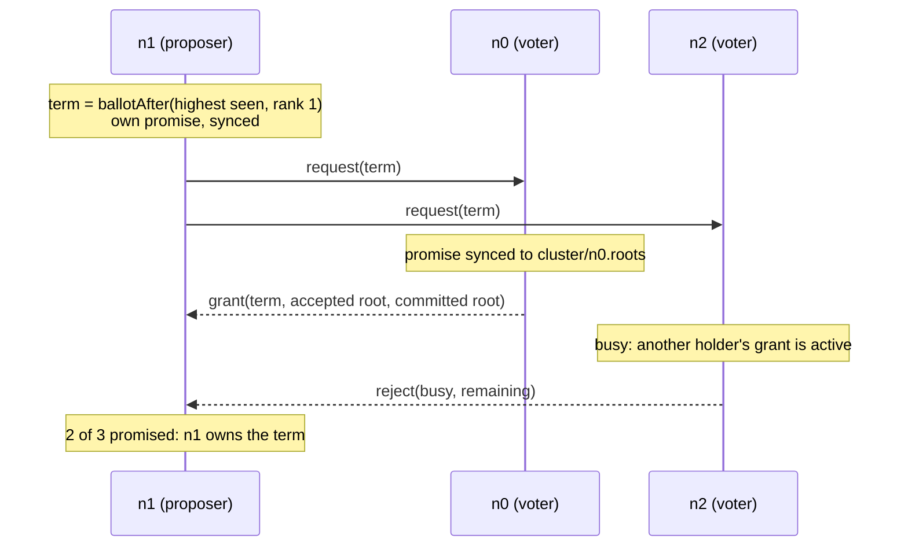
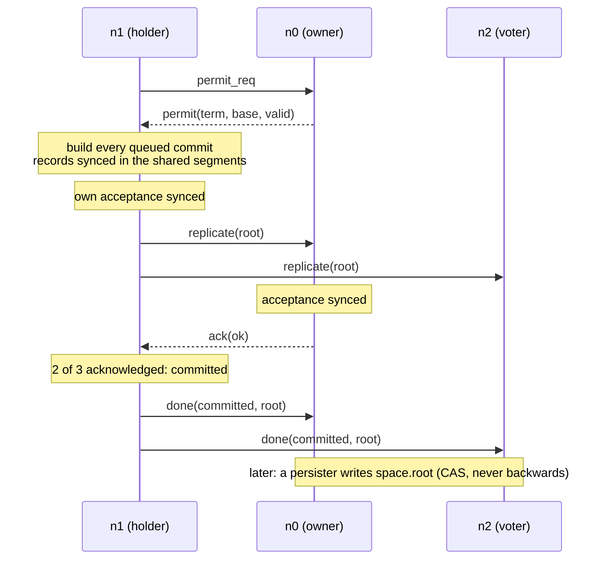

# 13. Several processes, one database: the ideas behind cluster mode

<!-- example: examples/cluster/13_terms_and_majorities.st -->
Program: [examples/cluster/13_terms_and_majorities.st](../../examples/cluster/13_terms_and_majorities.st).
Previous: [12. What is refused, and why](12-refusals.md). Next: [14. A three-node cluster](14-a-three-node-cluster.md).

> **Status.** Cluster mode belongs to protoBaseST 0.2.0, which is not released. The protocol core,
> the simulator that tests it, the transports, the coordinator shell and the shared tier are
> built; commits and reads through the coordinator (Tasks 23 and 24 of the
> [cluster plan](../superpowers/plans/2026-11-13-cluster-mode.md)) and the persister (Task 25) are
> not yet. This chapter explains the design; it has no code that depends on the missing parts.
> Chapters 14 and 15 mark every block that does not run yet.

This chapter has no new API to learn. It is the reasoning that the next three chapters assume.
Every rule here is `proto_db`'s: protoBaseST follows its cluster protocol rule by rule, including
the mistakes `proto_db` made and fixed, which are told below because each one explains a rule.
The normative text is `proto_db`'s coordinator protocol (`docs/source/coordinator-protocol.rst`
in the protoBase repository); this chapter is the guided tour.

## Why share one database between processes

Picture the ERP of [erp.md](erp.md) running on three application servers, each with the
database embedded in its own process, all of them writing the same database. A clerk on any
server can commit; a report on any server reads its own snapshot without asking anyone; if one
server dies, no commit that any server acknowledged is lost. There is no database server to run.
That is the deployment `proto_db`'s cluster is built for, and it stays in the tradition GemStone
opened: objects persist as objects, shared by every session, with no server-side query language in
between.

You can already put several protoBaseST processes on one directory without a cluster (chapter 9,
"Across processes"). So the first question is why that is not enough.

## The obvious approach: a lock on the storage

Standalone protoBaseST serialises commits with a lock: a commit takes `space.lock` (an `flock`),
reads the current root, builds its new root on it, and renames `space.root` (chapter 10). Two
processes cannot publish roots built on the same predecessor, because only one holds the lock.
Why not keep that for any number of machines?

**A lock that is held cannot be taken back.** If the process holding it is paused (a long garbage
collection, a frozen virtual machine, a `SIGSTOP`), every writer waits. The usual remedy is a lock
that expires: a lease. But a lease alone is unsafe, and this is the first lesson of `proto_db`'s
history (lesson L4): the paused holder does not know its lease expired. It wakes up, finishes the
write it had started, and overwrites the work of the process that took the lease after it. Expiry
needs a second half, **fencing**: every write carries a token, and whoever stores it refuses a
token older than one it has already seen. A plain `flock` has no token.

**The storage becomes the arbiter.** `proto_db`'s first cluster design (D5) let every commit
publish its root with a compare-and-swap on the storage, the loser retrying. The maintainer
reverted it (D44): every lost race costs storage round trips and a full retry of the transaction,
so the write ceiling is the storage's latency, not the network's. With an object store, that is
tens of milliseconds per contended commit.

**Locks across machines are only as good as the file system.** `flock` on a network file system is
reliable on some and not on others.

So `proto_db` resolves contention **among the processes**, over the network, with established
techniques (a majority lease with terms, which is Paxos phase 1, and a majority-acknowledged
commit point). The storage keeps one compare-and-swap, as fencing only, written off the commit
path.

> **Honest scope of the port.** protoBaseST's cluster runs over **one shared directory**: every
> member reads and writes the same `PBFileStorage`, and each member keeps its acceptor log in
> `cluster/<id>.roots` inside it. That protects commits from the failure of *processes*, and it is
> the whole coordination protocol; it does not protect you from losing the directory itself.
> Separate disks per member with an object store (tiered storage) are `proto_db`'s and are not
> ported (chapter 16). On one machine, today, the standalone lock is simpler and faster.

## Members, voters and majorities

A cluster has a fixed list of members (`PBPeer`: an id, a host, a port); there is no dynamic
membership. A member's **rank** is the index of its id in the ids sorted in code point order. By
default the first three ids are the **voters**, and every other member is a **learner**: it can
own a term and commit, but it never grants, accepts or counts. A **majority** is `V // 2 + 1`
voters.

```smalltalk
three := PBMembership peers: (peers value: #('n2' 'n0' 'n1')) voters: nil.
lesson check: 'ranks follow the sorted ids' is: three ids equals: #('n0' 'n1' 'n2').
lesson check: 'three voters' is: three voters equals: #('n0' 'n1' 'n2').
lesson check: 'a majority of three is two' is: three majority equals: 2.
```

```smalltalk
five := PBMembership peers: (peers value: #('n0' 'n1' 'n2' 'n3' 'n4')) voters: nil.
lesson check: 'five members, three voters' is: { five voters. five isVoter: 'n4' } equals: { #('n0' 'n1' 'n2'). false }.
lesson check: 'an even voter set is refused' signals: PBValidationError containing: 'odd'
  during: [PBMembership peers: (peers value: #('n0' 'n1' 'n2' 'n3')) voters: #('n0' 'n1' 'n2' 'n3')].
```

Why an odd, fixed set? Any two majorities of the same voters share at least one voter. That
single shared voter is what every safety argument below rests on: whatever one majority promised
or accepted, any later majority contains someone who remembers it. An even set adds a voter
without adding a failure it can survive. Every message carries `'vs'`, a CRC-32 of the voter ids, so
a member configured with another voter set is ignored instead of helping a quorum (lesson L25).

## Terms are ballots

Before a member can hand out write permissions it must **own a term**. A term is a number, and
it is a Paxos ballot: the member asks every voter to promise it, and wins with a majority of
promises.

Two members asking at the same moment must never ask for the same term, or two owners could be
elected by overlapping majorities (`proto_db` fix round 2 of D46, lesson L24). So the low 12 bits
of a term are the proposer's rank: the next ballot is the smallest number above everything the
member has seen whose low 12 bits are its rank.

```smalltalk
lesson check: 'the first ballot of rank 0 and of rank 1'
  is: { PBMembership ballotAfter: 0 rank: 0. PBMembership ballotAfter: 0 rank: 1 } equals: #(4096 1).
lesson check: 'above a term seen, the next ballot of rank 0'
  is: (PBMembership ballotAfter: 4097 rank: 0) equals: 8192.
lesson check: 'the rank is the term modulo 4096' is: (PBMembership ballotAfter: 70000 rank: 2) \\ 4096 equals: 2.
```

(A cluster therefore has at most 4096 members.) A voter grants a term only above every term it has
promised, and it **syncs the promise to its acceptor log before it answers**. That order is the
whole point: a voter that crashes and restarts reads its promises back and cannot grant an older
term again. `proto_db` once synced the log only in its `fsync` durability mode; a power loss could
then forget a promise (defect D-SAFE-2, lesson L10). protoBaseST syncs the log always.



## The lease, and why timing never decides safety

A grant is also a lease: the voter refuses other terms for `leaseDuration` on its own clock. The
winner believes its lease for less, `leaseDuration - driftMargin`, measured **from the moment it
sent the request**, not from the moment it won. (Measuring from the win let two beliefs overlap
when the grants were delayed: lesson L5.)

`driftMargin` is at least two thirds of the lease (ruling R78b), so the holder believes for at most
a third of what its granters promised. That covers clocks that run up to three times apart. A
smaller margin is refused when the configuration is built:

```smalltalk
config := PBClusterConfig nodeId: 'n0' peers: (peers value: #('n0' 'n1' 'n2')) options: (Dictionary new
  at: #leaseDuration put: 2000; yourself).
lesson check: 'driftMargin defaults to 2/3 of the lease, the belief to a third'
  is: { config driftMargin. config belief } equals: #(1333334 666666).
lesson check: 'a margin below 2/3 of the lease is refused (R78b)' signals: PBValidationError containing: 'R78b'
  during: [PBClusterConfig nodeId: 'n0' peers: (peers value: #('n0' 'n1' 'n2')) options: (Dictionary new
    at: #leaseDuration put: 2000; at: #driftMargin put: 200; yourself)].
```

(The accessors answer microseconds; the options are milliseconds.) Now the important part:
**this timing argument is not what keeps commits safe.** `proto_db`'s principle P5 (ruling R82)
is that every safety argument must hold under arbitrary delay, loss, duplication and reordering of
messages, arbitrary pauses of processes and clocks at any rate. Timers only drive liveness, and
when one fires the result is always a conservative failure: a timeout, an abandoned term, a
retried commit, or an unknown outcome. The margin keeps two owners from wasting each other's work.
What keeps a paused old owner from doing damage is the fencing below, which does not read any clock.

A sentence of the form "by the time X happens, Y has ended" is a statement about clocks, and under
P5 it is not an argument. Keep that sentence in mind; it is how `proto_db` found two of its
worst bugs.

## Write permissions

`proto_db`'s first majority lease was acquired by every commit. That cost 12.6 syncs per commit
across the cluster: 61 commits per second on three peers, against 588 for rqlite on the same
machine (decision D50, lesson L21). The fix splits the work:

- the **owner** of a term hands out short **write permissions**, first come first served, its own
  commits included;
- each member groups the commits of its own threads (in protoBaseST, its actors) into one
  **round** per permission: group commit;
- a holder never commits another member's transactions.

A permission carries the base root to build on and how long it is valid; the holder measures that
validity from the send of its request, as for the lease. protoBaseST issues one permission at a
time (`proto_db`'s `DEPTH = 0`; pipelined permissions are not ported, chapter 16).

Inside its permission the holder builds each queued transaction on the root the previous one
produced: validation, merge and path copies are the same code as standalone mode (chapters 5 and
6). One rule protects the end of the window, the **send reserve** (R121, lesson L22): with less
than `sendReserve` left, the round sends nothing and its commits get a retryable
`PBConflictError`. Sending at the last instant would turn a commit that could have been retried
into one whose outcome nobody knows.

## The commit point: a majority of synced acceptances

The holder sends the new root to the voters (`'replicate'`). Before that, the commit's records are
already synced in the shared segment: a root never travels without its records (lesson L11). A
voter **accepts** the root when:

- its label (the term it was built under) is not below the highest term the voter promised: the
  **ballot rule**;
- it orders at or above the root the voter accepted, in the one order of roots, `(label, epoch,
  segment, offset)`, the way Raft orders a log by `(term, index)`;
- it is built on the voter's accepted root, or on a root the voter knows (log matching);

then it **syncs the acceptance to its log, and only then acknowledges**. The **commit point** is a
majority of voters (the holder's own acceptor included) having acknowledged, observed within the
permission. The holder then broadcasts `'done'`, every member learns the new committed root, and a
**persister** writes `space.root` later, by compare-and-swap, never moving it backwards.



Why a majority, and not "the owner wrote it"? Because the next owner learns the past from a
majority of promises (its phase 1: every grant reports the voter's accepted root), and that
majority shares a voter with the majority that acknowledged the commit. So the next term sees the
commit and builds on it. This is the second lesson in the list: a weaker rule ("the release
message says it is certain") let four message schedules make a stale root look committed (D45
amendment 6, lesson L8).

### Which root a new term builds on

A new owner takes the highest root its granters reported, the **phase-1 value**. When some granter
is unsure about an earlier term (its outcome was unknown to it), the holder runs a recovery round
and asks the voters what they hold. `proto_db` once ended that round as soon as a majority of
witnesses had answered, with the classic majority argument. A reviewer built a schedule, a slow
clock and one delayed message, in which that lost an acknowledged commit (finding C1, lesson L15).
The fix: the base is never below the phase-1 value (the **phase-1 floor**, R127). protoBaseST has
the floor from its first version, and the C1 schedule is a fixed test of its simulator
(`tests/unit/sim_base_choice.st`, case 1).

### Three outcomes

So a commit can end three ways, and only two of them are definite:

| Outcome | What it means | `run:` |
|---|---|---|
| committed | a majority accepted the root within the permission | answers |
| `PBConflictError` | **nothing that could be accepted left the node** | retries |
| `PBOutcomeUnknownError` | anything else: the root left and the majority was not observed | never retries |

"Unknown" is the honest answer of a distributed system: after the root has left, a lost
acknowledgement, a stalled thread or a crash can keep the node from learning what the voters did.
Reporting a failure would be a lie when a majority accepted it; retrying would apply it twice.
Chapter 15 shows how an application settles an unknown outcome.

## Fencing, three times

The word appears in three places in the protocol. They are different mechanisms; keep them apart.

| | What is fenced | By what | Why |
|---|---|---|---|
| The fencing token | an old owner or holder | **the term itself**: the ballot rule at the voters; the persisted-root compare-and-swap at the storage | a paused holder whose lease ended without its knowing cannot get a root accepted once a majority promised a newer term, whatever its clock says |
| A fenced node | a whole member, **for the life of its process** | any unexpected error escaping one of its actors | see below |
| A fenced term | one ownership | a majority of permanent refusals of its renewal (R149) | see "The renewal back-off" below |

**Why a node fences itself for life.** The coordinator's rules are pure: each step reads the state,
decides, writes the log, publishes the new state, and only then replies. An unexpected error (a
bug, not a failed write) means a step stopped somewhere in that sequence, and the node can no
longer prove that what it holds in memory is what its log says or what it told the others. A node
that kept voting might acknowledge a root it never synced, or grant a term twice. The safe answer
is to stop being a witness: a fenced node grants nothing, answers a replication with
`ack(ok = false)`, and every local commit gets `PBUnexpectedError` naming the cause. It does not try
to repair itself, because repair would need exactly the certainty it lost. The cure is a restart:
a new process reloads the state from the synced log, which is the truth, under a new incarnation
(replies meant for the old process are then ignored, lesson L12).

A failed **write** to the log or the storage is different: the node enters the *tier failed* state
(R57). It refuses everything, because it can no longer make anything durable, until it is reopened
on a healthy disk. And a node must never acknowledge a write that failed.

## The startup grace

A member restarted on its intact disk reloads its promises, so it cannot grant an older term again.
It still refuses grants for `startupGrace` after it starts (default `leaseDuration +
driftMargin`): a lease its previous life granted may still be running at its holder, and granting a
new term at once would cut that holder's work short. Since ruling R82 this is an efficiency rule,
not a safety rule: the restored promise and the ballot rule already make an overlap harmless to
commits. Even so, a member restarted over a log that has served refuses, at attach, a grace shorter
than the default (lesson L17; a one-member cluster has no lease to wait out and is exempt).
Acceptances are allowed during the grace.

## A node that lost its disk: rejoin by ballot

An empty acceptor log is ambiguous: it is either a member joining a brand-new cluster, or a member
whose disk was wiped, which may have acknowledged a root just before the loss, under a lease whose
holder is still counting that acknowledgement.

**The obvious approach** is to wait: refuse to vote for *restart_grace*, long enough for every
lease the lost log served to end. That was `proto_db`'s first fix, and a review probe lost an
acknowledged commit with the wiped node's timer running 1.3 times as fast as the holder's (lesson
L13): the wait was shorter, in real time, than the lease it was meant to outlast. Exactly the
sentence warned about above.

**The fix is a ballot** (R78a). Until it has rejoined, the member grants nothing, acknowledges
nothing, and answers queries `empty`. It asks the other voters what they know (a plain round),
then:

- if every other voter answered, none holds an accepted root and none reports any term, it is a
  cluster's first start (`new`, R51) and the member simply logs its rejoined marker;
- otherwise it picks a ballot above every promise and label reported, asks again with it, and
  needs `V - majority + 1` witnesses that durably promised that ballot. That many witnesses
  intersect every majority that could have acknowledged a root R with the lost log: such a witness
  either accepted R before its promise (and reports it) or will never accept it after, because R's
  label is below the ballot. No timer appears in the argument.

Then the member logs the promise, the accepted root and the rejoined marker, in that order, each
synced, and is a witness again. It never replicates under a term below its rejoin ballot (lesson
L14). Losing the logs of a **majority** of voters is outside the failure model: no ballot can be
confirmed, and the operator decides with `forceRejoin` (chapter 15).

## The renewal back-off (R149)

An owner with demand renews its lease when half of its belief is left. In `proto_db` up to
2.0.0rc3, a renewal that a majority refused was simply tried again, and since a majority of
refusals ends a round in one round trip, the owner sent a renewal, and every voter made a grant
decision, **once per round trip** until its lease ran out (protoBase issue #1). Nothing unsafe, but
a storm.

The fix (rulings R149 and R149a, `proto_db` 2.0.0rc4), which protoBaseST follows:

- a refusal is **permanent** when its reason is `'stale_term'` or `'term_taken'`, or when the refusing
  voter reports a highest term above ours: its promises only grow, so it will never renew us;
- when the permanent refusals exceed `V - majority` (a majority can no longer be reached), the
  **term is fenced**: no further renewal, no new permission, the queue refused `'ending'`; an
  outstanding permission still ends normally by its `'done'`, and then the term is released;
- any other renewal round that is not won **backs off**: no renewal before the longest of the
  refusals' remaining promise, `requestTimeout / 4` and 1 ms, never past the lease.

It is liveness only: ending an ownership early is always allowed, and a delayed renewal can only
make a lease end sooner. The ported tests are `tests/unit/cluster_renew_backoff_rules.st`.

## How protoBaseST is built to get this right

The rules live in a *sans-IO* core: every rule is a pure function of an immutable state, an event
and a time `now`, answering a new state and a list of effects (send this, append that, start a
timer). Thin actors perform the effects and never wait. The same core runs in a deterministic,
seeded, virtual-time simulator that drops, duplicates, delays and reorders messages, crashes nodes
with or without their disks and runs clocks at different rates, and checks the invariants after
every step. **No test reads a wall clock to decide anything.** Each of `proto_db`'s fixes keeps its
counterexample as a *planted defect*: a test-only subclass of the rules that reintroduces the old
mistake and must make its scenario fail (`tests/unit/sim_lessons.st` runs one per lesson).

## What to take away

- A lock alone cannot be revoked safely; a lease needs fencing, and the fencing token is the term.
- Terms are ballots whose low 12 bits are the proposer's rank; promises and acceptances are synced
  before the reply that relies on them.
- A commit is committed when a majority of voters synced its root; conflict means nothing left the
  node; everything else is unknown, and is never retried blindly.
- Timers only decide liveness. A node fenced by an internal error stays fenced until its process
  restarts from its log; a wiped node rejoins by a ballot, never by waiting.
