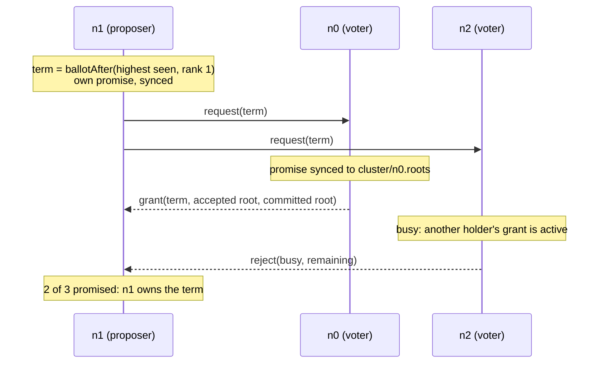
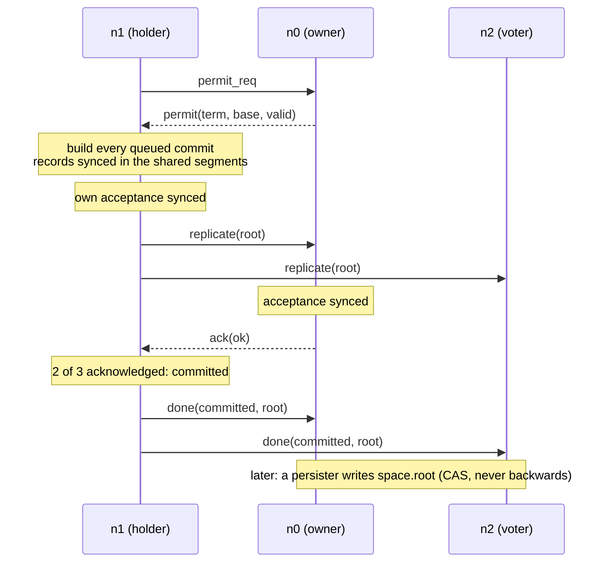

# 13. Several processes, one database: the ideas behind cluster mode

<!-- example: examples/cluster/13_terms_and_majorities.st -->
Program: [examples/cluster/13_terms_and_majorities.st](../../examples/cluster/13_terms_and_majorities.st).
Previous: [12. What is refused, and why](12-refusals.md). Next: [14. A three-node cluster](14-a-three-node-cluster.md).

> **Status.** Cluster mode was released in protoBaseST 0.2.0 (2026-11-19). It is built and
> tested: the protocol core, the simulator that tests it, the transports, the coordinator shell,
> the shared tier, commits, reads and the persister, real processes killed with `kill -9`, and a
> first measurement (chapter 16). The final verification of the
> [cluster plan](../superpowers/plans/2026-11-13-cluster-mode.md) has run: the long soak and the
> full timer audit passed at the final code (chapter 16 gives the seed counts). This chapter
> explains the design; chapters 14 to 16 run it.

This chapter has no new API to learn. It is the reasoning that the next three chapters assume.
Every rule here is `proto_db`'s: protoBaseST follows its cluster protocol rule by rule, including
the mistakes `proto_db` made and fixed, which are told below because each one explains a rule. The
few places where the port differs (one permission at a time, an optional frame key, a few
additions that only affect liveness) are listed in [deviations.md](../deviations.md#cluster-mode).
The normative text is `proto_db`'s coordinator protocol (`docs/source/coordinator-protocol.rst`
in the protoBase repository); this chapter is the guided tour. The story is told in plain words;
the identifiers of `proto_db`'s decisions, lessons and rulings, and the tests that check each idea,
are gathered in [the sources table](#sources) at the end.

## Why share one database between processes

Picture the ERP of [erp.md](erp.md) running on three application servers, each with the
database embedded in its own process, all of them writing the same database. A clerk on any
server can commit; a report on any server reads its own snapshot without asking anyone; if one
server dies, no commit that any server acknowledged is lost. There is no database server to run.
That is the deployment `proto_db`'s cluster is built for, and it stays in the tradition GemStone
opened: objects persist as objects, shared by every session, with no server-side query language in
between.

You can already put several protoBaseST processes on one directory without a cluster (chapter 9,
"Across processes"). So the first question is why that is not enough.

## The obvious approach: a lock on the storage

Standalone protoBaseST serialises commits with a lock: a commit takes `space.lock` (an `flock`),
reads the current root, builds its new root on it, and renames `space.root` (chapter 10). Two
processes cannot publish roots built on the same predecessor, because only one holds the lock.
Why not keep that for any number of machines?

**A lock that is held cannot be taken back.** If the process holding it is paused (a long garbage
collection, a frozen virtual machine, a `SIGSTOP`), every writer waits. The usual remedy is a lock
that expires: a lease. But a lease alone is unsafe, and it is one of the first lessons `proto_db`
learnt: the paused holder does not know its lease expired. It wakes up, finishes the write it had
started, and overwrites the work of the process that took the lease after it. Expiry needs a
second half, **fencing**: every write carries a token, and whoever stores it refuses a token older
than one it has already seen. A plain `flock` has no token.

**The storage becomes the arbiter.** A later `proto_db` design let every commit publish its root
with a compare-and-swap on the storage, the loser retrying. The maintainer reverted it: every lost
race costs storage round trips and a full retry of the transaction, so the write ceiling is the
storage's latency, not the network's. With an object store, that is tens of milliseconds per
contended commit.

**Locks across machines are only as good as the file system.** `flock` on a network file system is
reliable on some and not on others.

So `proto_db` resolves contention **among the processes**, over the network, with established
techniques: a majority lease with numbered terms (the first phase of the Paxos algorithm) and a
commit point that a majority acknowledges. The storage keeps one compare-and-swap, as fencing only,
written off the commit path.

> **Honest scope of the port.** protoBaseST's cluster runs over **one shared directory**: every
> member reads and writes the same `PBFileStorage`, and each member keeps its acceptor log in
> `cluster/<id>.roots` inside it. That protects commits from the failure of *processes*, and it is
> the whole coordination protocol; it does not protect you from losing the directory itself.
> Separate disks per member with an object store (tiered storage) are `proto_db`'s and are not
> ported (chapter 16). On one machine the standalone lock is simpler, and faster: in a first,
> indicative measurement a standalone process committed about 46 small transactions per second
> where three member processes together committed about 26 (chapter 16). A cluster buys
> survival of a process's failure, not speed.

## Members, voters and majorities

A cluster has a fixed list of members (`PBPeer`: an id, a host, a port); there is no dynamic
membership. A member's **rank** is the index of its id in the ids sorted in code point order. By
default the first three ids are the **voters** (every member, in a cluster of fewer than three),
and every other member is a **learner**: it can own a term and commit, but it never grants,
accepts or counts. A **majority** is `V // 2 + 1` of the `V` voters.

```smalltalk
three := PBMembership peers: (peers value: #('n2' 'n0' 'n1')) voters: nil.
lesson check: 'ranks follow the sorted ids' is: three ids equals: #('n0' 'n1' 'n2').
lesson check: 'three voters' is: three voters equals: #('n0' 'n1' 'n2').
lesson check: 'a majority of three is two' is: three majority equals: 2.
```

```smalltalk
five := PBMembership peers: (peers value: #('n0' 'n1' 'n2' 'n3' 'n4')) voters: nil.
lesson check: 'five members, three voters' is: { five voters. five isVoter: 'n4' } equals: { #('n0' 'n1' 'n2'). false }.
lesson check: 'an even voter set is refused' signals: PBValidationError containing: 'odd'
  during: [PBMembership peers: (peers value: #('n0' 'n1' 'n2' 'n3')) voters: #('n0' 'n1' 'n2' 'n3')].
```

Why an odd, fixed set? Any two majorities of the same voters share at least one voter. That
single shared voter is what every safety argument below rests on: whatever one majority promised
or accepted, any later majority contains someone who remembers it. An even set adds a voter
without adding a failure it can survive. So in a cluster of three or more members an explicit
voter set must be odd and hold at least three members.

Requests, renewals, queries and replications carry `'vs'`, a CRC-32 of the sorted voter ids
joined with commas, so a member configured with another voter set is ignored instead of helping a
quorum.

## Terms are ballots

Before a member can hand out write permissions it must **own a term**. The intuition first. A term
is a numbered claim: "I, n1, claim the right to coordinate writes, under number 8193". A voter
that has promised a claim refuses every claim with a lower number, for ever. So a higher claim
shuts every older one out, and no clock is involved:

```text
n0 asks n2 to promise 4096        n2 promises 4096
n1 asks n2 to promise 8193        n2 promises 8193 (higher)
n0's late message under 4096      n2 refuses it: it promised 8193
```

A member **owns** a term once a majority of voters promised it. Database people know this as a
Paxos ballot: asking for promises is the algorithm's first phase.

Two members asking at the same moment must never ask for the same number, or two owners could be
elected by overlapping majorities. So the low 12 bits of a term are the proposer's rank: the next
ballot is the smallest number above everything the member has seen whose low 12 bits are its rank.

```smalltalk
lesson check: 'the first ballot of rank 0 and of rank 1'
  is: { PBMembership ballotAfter: 0 rank: 0. PBMembership ballotAfter: 0 rank: 1 } equals: #(4096 1).
lesson check: 'above a term seen, the next ballot of rank 0'
  is: (PBMembership ballotAfter: 4097 rank: 0) equals: 8192.
lesson check: 'the rank is the term modulo 4096' is: (PBMembership ballotAfter: 70000 rank: 2) \\ 4096 equals: 2.
```

(A cluster therefore has at most 4096 members.) A voter grants a term only above every term it has
promised, and it **syncs the promise to its acceptor log before it answers**. That order is the
whole point: a voter that crashes and restarts reads its promises back and cannot grant an older
term again. `proto_db` once synced the log only in its `fsync` durability mode, and a power loss
could then forget a promise. Since that fix, `proto_db` and protoBaseST sync every promise,
acceptance and rejoined marker whatever the durability mode; only the log's `#committed` entries
are written without a sync of their own, and ride on the next one (chapter 14 explains why that is
safe).



## The lease, and why timing never decides safety

A grant is also a lease: the voter refuses other terms for `leaseDuration` on its own clock. The
winner believes its lease for less, `leaseDuration - driftMargin`, measured **from the moment it
sent the request**, not from the moment it won. (Measuring from the win let two beliefs overlap
when the grants were delayed.)

`driftMargin` is at least two thirds of the lease, so the holder believes for at most a third of
what its granters promised. That covers clocks that run up to three times apart. A smaller margin
is refused when the configuration is built:

```smalltalk
config := PBClusterConfig nodeId: 'n0' peers: (peers value: #('n0' 'n1' 'n2')) options: (Dictionary new
  at: #leaseDuration put: 2000; yourself).
lesson check: 'driftMargin defaults to 2/3 of the lease, the belief to a third'
  is: { config driftMargin. config belief } equals: #(1333334 666666).
lesson check: 'a margin below 2/3 of the lease is refused (R78b)' signals: PBValidationError containing: 'R78b'
  during: [PBClusterConfig nodeId: 'n0' peers: (peers value: #('n0' 'n1' 'n2')) options: (Dictionary new
    at: #leaseDuration put: 2000; at: #driftMargin put: 200; yourself)].
```

(The accessors answer microseconds; the options are milliseconds.) Now the important part:
**this timing argument is not what keeps commits safe.** `proto_db` holds a principle that every
safety argument must hold under arbitrary delay, loss, duplication and reordering of messages,
arbitrary pauses of processes, and clocks at any rate. Timers only drive liveness, and when one
fires the result is always a conservative failure: a timeout, an abandoned term, a retried commit,
or an unknown outcome. The margin keeps two owners from wasting each other's work. What keeps a
paused old owner from doing damage is the fencing by terms described below, which does not read
any clock.

A sentence of the form "by the time X happens, Y has ended" is a statement about clocks, and under
that principle it is not an argument. Keep that sentence in mind; it is how `proto_db` found two of
its worst bugs.

## Write permissions

`proto_db`'s first majority lease was acquired by every commit. That cost 12.6 syncs per commit
across the cluster: 61 commits per second on three peers, against 588 for rqlite on the same
machine (figures measured by `proto_db`, not by this port). The fix splits the work:

- the **owner** of a term hands out short **write permissions**, first come first served, its own
  commits included;
- each member groups the commits of its own threads (in protoBaseST, its actors) into one
  **round** per permission: group commit;
- a holder never commits another member's transactions.

A permission carries the base root to build on and how long it is valid; the holder measures that
validity from the send of its request, as for the lease. protoBaseST issues one permission at a
time (DEPTH 0); `proto_db` pipelines one more (DEPTH 1), which is not ported (chapter 16). One
consequence is measured: adding members does not add throughput. Three members writing disjoint
roots committed about 0.93 times as many transactions per second as one member alone, and on one
hot key 0.57 times, because every commit of the cluster waits for the one permission (chapter 16, *What a commit costs*).

Inside its permission the holder builds each queued transaction on the root the previous one
produced: validation, merge and path copies are the same code as standalone mode (chapters 5 and
6). One rule protects the end of the window, the **send reserve**: with less than `sendReserve`
left, the round sends nothing and its commits get a retryable `PBConflictError`. Sending at the
last instant would turn a commit that could have been retried into one whose outcome nobody knows.

## The commit point: a majority of synced acceptances

Every root carries a **label**: the term it was built under. Roots are ordered by `(label, epoch,
segment, offset)`, the way Raft orders a log by `(term, index)`: a root of a later term is above
every root of an earlier one, and within a term the epochs count up.

The holder sends the new root to the voters (`'replicate'`). Before that, the commit's records are
already synced in the shared segment: a root never travels without its records. A voter
**accepts** the root when:

- its label is not below the highest term the voter promised: the **ballot rule**;
- it orders at or above the root the voter accepted;
- within one term, it is built on the very root the voter accepted (**log matching**); the first
  root of a new term needs only the ballot rule, because its base came out of the owner's phase 1
  (below). A second root built on the same base in one term (a *sibling*) is refused.

An example, with one voter that accepted `A`, labelled 4096. A root `B` of term 4096 built on `A`
is accepted. A root `B'` of term 4096 built on some other root is refused: the voter does not hold
its predecessor. A root `C` of term 8192 built on any root is accepted, provided the voter has not
promised a term above 8192.

Then the voter **syncs the acceptance to its log, and only then acknowledges**. The **commit
point** is a majority of voters (the holder's own acceptor included) having acknowledged, observed
within the permission. The holder then broadcasts `'done'`, every member learns the new committed
root, and a **persister** writes `space.root` later, by compare-and-swap, never moving it
backwards.



Why a majority, and not "the owner wrote it"? Because the next owner learns the past from a
majority of promises (its **phase 1**: every grant reports the voter's accepted root), and that
majority shares a voter with the majority that acknowledged the commit. So the next term sees the
commit and builds on it. This is another lesson `proto_db` learnt: a weaker rule ("the release
message says it is certain") let four message schedules make a stale root look committed.

### Which root a new term builds on

A new owner takes the highest root its granters reported, the **phase-1 value**. Sometimes a
granter is unsure about an earlier term: it accepted a root but never learnt whether that root was
committed. Then the owner runs a **recovery round**: it asks the voters, without asking for any
promise, which root they hold, and their answers are the **witnesses**.

The obvious way to end that round is at the first majority of answers, by the usual argument
"every committed root was accepted by a majority, and any majority meets it". `proto_db` did that,
and a reviewer found a schedule with five voters, a to e, in which it lost an acknowledged commit:

1. e owns an older term and sends its root R' to the voters. b accepts it; e's copy for c is
   delayed in the network.
2. a wins a newer term from b and d. b reports R', so a's phase-1 value is R', but b is unsure
   whether R' was committed, and a runs a recovery round. c and d answer it with an older root,
   and with a's own answer that is a majority: the round ends.
3. Now e's delayed copy reaches c. c promised nothing in a recovery round, so it accepts R'. e
   counts b, c and itself, three of five, and acknowledges R' to its caller. a, which ended its
   round at the older root, builds on it, and every voter accepts a's root over R' by the ballot
   rule: an acknowledged commit is gone.

The flaw is that an answer which promised nothing says nothing about what its sender accepts
*afterwards*, however many such answers there are. The fix: the base is never below the phase-1
value, which came from promises (the **phase-1 floor**). protoBaseST has the floor from its first
version, and this schedule is a fixed test of its simulator. `proto_db`'s coordinator protocol
draws it as a sequence diagram (`coordinator-protocol/seq-c1`).

### Outcomes

Once a commit has a permission and has sent its root, it can end three ways, and only two of them
are definite:

| Outcome | What it means | `run:` |
|---|---|---|
| committed | a majority accepted the root within the permission | answers |
| `PBConflictError` | **nothing that could be accepted left the node** | retries |
| `PBOutcomeUnknownError` | the root left and the majority was not observed | never retries |

Before a permission, a commit can also time out (`PBTimeoutError`, no permission came), or meet a
node that is stopping (`PBClosedError`) or fenced (`PBUnexpectedError`, below). Nothing left the
node in those cases, and `run:` retries none of them. A protocol violation detected after the root
was sent is a `PBCorruptionError`, never an unknown outcome.

"Unknown" is the honest answer of a distributed system: after the root has left, a lost
acknowledgement, a stalled thread or a crash can keep the node from learning what the voters did.
Reporting a failure would be a lie when a majority accepted it; retrying would apply it twice.
Chapter 15 shows how an application settles an unknown outcome.

## A node that fences itself

The coordinator's rules are pure: each step reads the state, decides, writes the log, publishes
the new state, and only then replies. An unexpected error (a bug, not a failed write) means a step
stopped somewhere in that sequence, and the node can no longer prove that what it holds in memory
is what its log says or what it told the others. A node that kept voting might acknowledge a root
it never synced, or grant a term twice. The safe answer is to stop being a witness: a **fenced**
node grants nothing, answers a replication with `ack(ok = false)`, and every local commit gets
`PBUnexpectedError` naming the cause, for the life of its process. It does not try to repair
itself, because repair would need exactly the certainty it lost. The cure is a restart: a new
process reloads the state from the synced log, which is the truth, under a new incarnation
(replies meant for the old process are then ignored).

A failed **write** to the log or the storage is different: the node enters the *tier failed*
state. It refuses everything, because it can no longer make anything durable, until it is
reopened on a healthy disk. And a node must never acknowledge a write that failed.

## The startup grace

Every member refuses grants for `startupGrace` after it starts, a cluster's first start
included (the default is `leaseDuration + driftMargin`): this is the `'starting'` refusal you will
meet in chapter 14. It matters after a restart. A member restarted on its intact disk reloads its
promises, so it cannot grant an older term again; but a lease its previous life granted may still
be running at its holder, and granting a new term at once would cut that holder's work short.

This is an efficiency rule, not a safety rule: the restored promise and the ballot rule already
make an overlap harmless to commits. Even so, a member restarted over a log that has served refuses,
when its space attaches, a grace shorter than the default (a one-member cluster has no lease to
wait out and is exempt). Over fresh logs any grace is accepted, 0 included, which is how
`proto_db`'s own tutorial starts its first cluster; the lessons here keep the default.

Acceptances are allowed during the grace: the acceptance rule above does not read it. (No test
checks this by name yet.)

## A node that lost its disk: rejoin by ballot

An empty acceptor log is ambiguous: it is either a member joining a brand-new cluster, or a member
whose disk was wiped, which may have acknowledged a root just before the loss, under a lease whose
holder is still counting that acknowledgement.

**The obvious approach** is to wait: refuse to vote for a *restart grace*, long enough for every
lease the lost log served to end. That was `proto_db`'s first fix, and a review probe lost an
acknowledged commit with the wiped node's timer running 1.3 times as fast as the holder's: the wait
was shorter, in real time, than the lease it was meant to outlast. Exactly the sentence warned
about above.

**The fix is a ballot.** Until it has rejoined, the member grants nothing, acknowledges nothing,
and answers queries `'empty'`. It asks the other voters what they know (a plain round), then:

- if every other voter answered, none holds an accepted root and none reports any term, it is a
  cluster's first start (`'new'`) and the member simply logs its rejoined marker;
- otherwise it picks a ballot above every promise and label reported, asks again with it, and
  needs `V - majority + 1` witnesses that durably promised that ballot. With three voters that is
  2: both other voters must promise the ballot. Any majority that acknowledged a root R together
  with the lost log contains at least one of them, and that witness either accepted R before its
  promise (and reports it) or will never accept it after, because R's label is below the ballot.
  No timer appears in the argument.
- if too few witnesses answer, it asks again, and stays rejoining.

Then the member logs the promise, the accepted root and the rejoined marker, in that order, each
synced, and is a witness again. It never replicates under a term below its rejoin ballot. Losing
the logs of a **majority** of voters is outside the failure model: too few witnesses are left, and
the operator decides with `forceRejoin` (chapter 15).

## The renewal back-off

An owner with demand renews its lease when half of its belief is left. In `proto_db` up to
2.0.0rc3, a renewal that a majority refused was simply tried again, and since a majority of
refusals ends a round in one round trip, the owner sent a renewal, and every voter made a grant
decision, **once per round trip** until its lease ran out
([protoBase issue #1](https://github.com/gamarino/ProtoDB/issues/1)). Nothing unsafe, but a
storm.

The fix (`proto_db` 2.0.0rc4), which protoBaseST follows:

- a refusal is **permanent** when its reason is `'stale_term'` or `'term_taken'`, or when the refusing
  voter reports a highest term above ours: its promises only grow, so it will never renew us;
- when the permanent refusals exceed `V - majority` (a majority can no longer be reached), the
  **term is fenced**: no further renewal, no new permission, the queue refused `'ending'`; an
  outstanding permission still ends normally by its `'done'`, and then the term is released;
- any other renewal round that is not won **backs off**: no renewal before the longest of the
  refusals' remaining promise, `requestTimeout / 4` and 1 ms, never past the lease.

It is liveness only: ending an ownership early is always allowed, and a delayed renewal can only
make a lease end sooner.

## Fencing, three times

The word "fencing" has now appeared in three places. They are different mechanisms; keep them
apart.

| | What is fenced | By what | Why |
|---|---|---|---|
| The fencing token | an old owner or holder | **the term itself**: the ballot rule at the voters; the persisted-root compare-and-swap at the storage | a paused holder whose lease ended without its knowing cannot get a root accepted once a majority promised a newer term, whatever its clock says |
| A fenced node | a whole member, **for the life of its process** | any unexpected error escaping one of its actors | it can no longer prove its memory matches its log |
| A fenced term | one ownership | a majority made unreachable by permanent refusals of its renewal | renewing again could never succeed |

## How protoBaseST is built to get this right

The rules live in a *sans-IO* core: every rule is a pure function of an immutable state, an event
and a time `now`, answering a new state and a list of effects (send this, append that, start a
timer). Thin actors perform the effects and never wait. The same core runs in a deterministic,
seeded, virtual-time simulator that drops, duplicates, delays and reorders messages, crashes nodes
with or without their disks and runs clocks at different rates, and checks the invariants after
every step. **No check asserts a duration, and the core never reads a clock**; the programs of
these chapters wait only on conditions, with a 60 s deadline that turns a hang into a failure. The
12 of `proto_db`'s lessons that have a counterpart in the protocol keep their counterexample as a
*planted defect*: a test-only subclass of the rules that reintroduces the old mistake and must make
its scenario fail.

## Sources

| Idea | `proto_db` identifier | Where the port tests it |
|---|---|---|
| A lease needs fencing | lesson L4 | `sim_acceptance.st` (3) |
| The storage compare-and-swap design, and its revert | decisions D5, D43, D44 | (design history) |
| Contention among the processes | decision D44, spec L1, L2 | |
| Differences of the port | | [deviations.md](../deviations.md#cluster-mode) |
| Voter fingerprint `'vs'` | lesson L25 | `sim_acceptance.st` (6) |
| Ballots carry the rank | fix round 2 of D46, lesson L24 | `13_terms_and_majorities.st` |
| Promises synced in every mode | defect D-SAFE-2, lesson L10 | `sim_grants.st` (8) |
| `#committed` entries ride on the next sync | ruling R67 | `sim_acceptance.st` (2) |
| The lease runs from the send | lesson L5 | `sim_leases.st` (3) |
| `driftMargin` at least two thirds | ruling R78b | `13_terms_and_majorities.st`; `sim_rejoin.st` (7) |
| Timers decide liveness only | principle P5, ruling R82 | the timer audit (chapter 16) |
| Write permissions, group commit | decision D50, lesson L21 | `sim_permits.st` (1) |
| One permission at a time | DEPTH 0 (`proto_db`: DEPTH 1, D55) | |
| Send reserve | ruling R121, lesson L22 | `sim_round_rules.st` (2), (7) |
| Records before the root | lesson L11 | |
| Log matching on roots | rule V2' | `sim_acceptance.st` (4) |
| Majority, not the release message | D45 amendment 6, lesson L8 | `sim_acceptance.st` (7) |
| The recovery round ended too early, and the phase-1 floor | finding C1, ruling R127, lesson L15 | `sim_base_choice.st` (1) |
| Replies to another incarnation dropped | lesson L12 | `sim_leases.st` (7) |
| Tier failed | ruling R57 | `cluster_coordinator_shell.st` (6), (10) |
| A short grace over a used log refused | lesson L17 | `cluster_coordinator_shell.st` (7); `16_configuration.st` |
| A fresh cluster's first start | rulings R50, R51 | `sim_rejoin.st` (3) |
| Rejoin by ballot, not by waiting | ruling R78a, lesson L13 | `sim_rejoin.st` (1), (2), (8) |
| No replication below the rejoin ballot | lesson L14 | `sim_rejoin.st` (4), (5) |
| Majority of logs lost | decision D46 | `sim_rejoin.st` (6) |
| Renewal back-off, fenced term | rulings R149, R149a | `cluster_renew_backoff_rules.st` |
| Planted defects, one per lesson | | `sim_lessons.st` |
| No clock in the core | | `sim_harness.st` (12) |

Numbers in parentheses are the numbered checks listed in each test file's header comment; the
tests are in `tests/unit/`.

## What to take away

- A lock alone cannot be revoked safely; a lease needs fencing, and the fencing token is the term.
- Terms are ballots whose low 12 bits are the proposer's rank; promises and acceptances are synced
  before the reply that relies on them.
- A commit is committed when a majority of voters synced its root; conflict means nothing left the
  node; once the root has left, anything else is unknown, and is never retried blindly.
- Timers only decide liveness. A node fenced by an internal error stays fenced until its process
  restarts from its log; a wiped node rejoins by a ballot, never by waiting.
